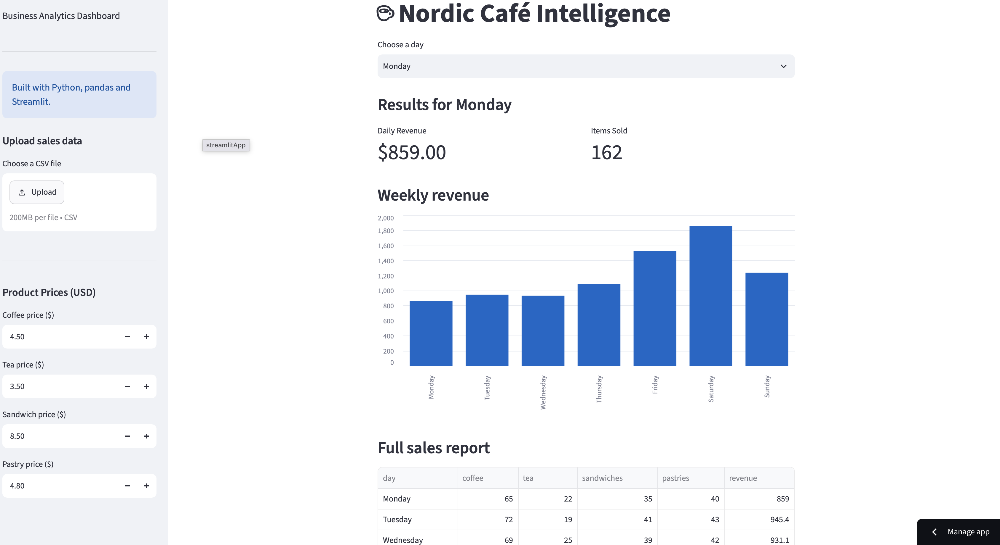

☕ Nordic Café Intelligence

AI-Powered Café Sales Analytics Dashboard

Nordic Café Intelligence is an interactive business analytics application built using Python, Streamlit, pandas, and Google Gemini.

The application helps café managers analyze sales performance, understand product revenue, and generate AI-powered management reports.

Features

Interactive Dashboard: Monitor daily and weekly sales performance.

CSV Uploads: Analyze custom café sales datasets.

Product Analytics: Identify best-selling and highest-revenue products.

Customizable Pricing: Adjust product prices and recalculate revenue instantly.

Business Recommendations: Generate rule-based operational insights.

Gemini AI Integration: Generate management reports using Google Gemini.

Downloadable Reports: Export analyzed sales data as CSV.

Data Validation: Detect missing and invalid sales values.

Technologies Used

Python

Streamlit

pandas

Google Gemini API

Git and GitHub

How to Run Locally

Download or clone this repository.

Create and activate a Python virtual environment.

Install dependencies using pip install -r requirements.txt.

Create .streamlit/secrets.toml with your own GEMINI_API_KEY.

Run the application using streamlit run app.py.

Example Data

The project includes fictional café sales data for testing and demonstration purposes.

The application currently supports CSV files containing the columns:

day,coffee,tea,sandwiches,pastries

Limitations

Revenue calculations do not include operating costs or profit margins.

AI-generated recommendations should be reviewed before business decisions are made.

The current application is designed for demonstration rather than production deployment.

Gemini API availability and usage limits depend on the configured account.

About This Project

This project was developed as part of my transition into technology, focusing on applied AI, business analytics, and practical automation.

It demonstrates my ability to build an interactive Python application, integrate a generative AI API, validate business data, and communicate analytical findings.

Future Improvements

More flexible CSV data formats

Profit and cost analysis

Downloadable PDF management reports

Additional data visualizations

Improved AI report formatting

## Live Demo

Try the application here: [Nordic Café Intelligence](https://nordic-cafe-intelligence-tgzem4vthbdkurzjvzsuzr.streamlit.app)

The public demo includes interactive sales analytics, CSV uploads,
customizable pricing, and business recommendations.

The Gemini AI report generator is currently disabled in the public demo
to prevent unauthorized API usage.

## Dashboard Preview

